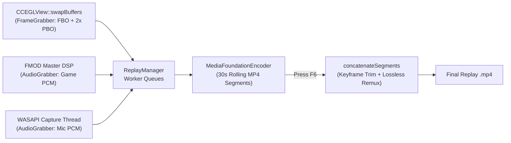

# 🎬 Instant Replay for Geometry Dash (Geode)

> **Developer:** ZeMo (`zemo.instant-replay`)  
> **Platform:** Windows 64-bit | **Geometry Dash:** `2.2081` | **Geode SDK:** `v5.10.1` | **Standard:** C++23

Hardware-accelerated, ShadowPlay-style background **Instant Replay** recorder built natively into Geometry Dash. Continuously buffers the last `N` seconds of gameplay (5s – 3600s) into rolling segments and exports an MP4 on demand (`F6`) with zero FPS drop.

> 🤖 **Using an LLM / AI Coding Assistant?**  
> Read **[AGENTS.md](./AGENTS.md)** (or **[CLAUDE.md](./CLAUDE.md)**) first — it documents every source file, thread boundary, Media Foundation pipeline detail, and Geode UI invariant.

---

## ✨ Key Features

- **1-Click Instant Replay (`F6`):** Saves the last `5` to `3600` seconds of gameplay into a ready-to-share `.mp4` file.
- **Hardware-Accelerated Encoding:** Uses Windows Media Foundation (`IMFSinkWriter`) with automatic fallback cascade:
  `AV1 (HW) → HEVC (HW) → H.264 (HW) → H.264 (Software)` across NVIDIA NVENC, AMD AMF, and Intel QuickSync.
- **Rate Control Modes:** Adaptive VBR (peak-constrained), Constant Bitrate (CBR), and Constant Quality (CQ).
- **Zero-Stutter OpenGL Capture:** GPU-side FBO scaling (`glBlitFramebuffer`), double-buffered asynchronous PBO readback (`GL_BGRA`), and phase-preserving frame pacing (`60`, `120`, `240` FPS).
- **Studio Multi-Track or Mixed Audio:**
  - **Game Audio:** Captured directly from the FMOD Master `ChannelGroup` DSP.
  - **Microphone Audio:** Low-latency event-driven WASAPI capture with live device selection.
  - Supports **2 separate AAC tracks** (for Premiere Pro / DaVinci Resolve / Vegas) or **real-time single-track mixing**.
- **In-Game Dashboard (`F9`):** 4-tab popup with live Premiere-style file size estimator, low disk space warnings, volume sliders, and folder picker.

---

## 🗂️ Architecture & Source Layout



| Path | Description |
| :--- | :--- |
| [`mod.json`](./mod.json) | Geode mod metadata, settings definitions, and default keybinds |
| [`CMakeLists.txt`](./CMakeLists.txt) | CMake build configuration & Win32 / Media Foundation libraries |
| [`AGENTS.md`](./AGENTS.md) | Comprehensive architectural & invariant guide for LLMs and developers |
| [`src/main.cpp`](./src/main.cpp) | Hooks (`CCEGLView`, `CCKeyboardDispatcher`, `FMODAudioEngine`, menus) & setting listeners |
| [`src/config/ReplayConfig.hpp`](./src/config/ReplayConfig.hpp) | Singleton configuration, bitrate/size estimators, and `mod.json` sync |
| [`src/capture/FrameGrabber.cpp`](./src/capture/FrameGrabber.cpp) | OpenGL FBO downscaler, async PBO pixel readback, and FPS limiter |
| [`src/capture/AudioGrabber.cpp`](./src/capture/AudioGrabber.cpp) | FMOD DSP game audio tap & WASAPI microphone capture/resampler |
| [`src/encoder/MediaFoundationEncoder.cpp`](./src/encoder/MediaFoundationEncoder.cpp) | `IMFSinkWriter` video/audio encoder & `IMFSourceReader` lossless segment combiner |
| [`src/recorder/ReplayManager.cpp`](./src/recorder/ReplayManager.cpp) | Segment rotation, single-track mic mixer, export file locking, and thread management |
| [`src/ui/ReplayPopup.cpp`](./src/ui/ReplayPopup.cpp) | In-game 4-tab settings and status popup (`F9`) |
| [`src/ui/CodecGuidePopup.cpp`](./src/ui/CodecGuidePopup.cpp) | In-game GPU codec guide popup |
| [`src/ui/ReplayNotification.cpp`](./src/ui/ReplayNotification.cpp) | Custom toast notification on replay save |

---

## 🛠️ Building (Windows)

1. Install [Geode CLI](https://github.com/geode-sdk/cli), [Geode SDK v5.10.1+](https://github.com/geode-sdk/geode), CMake 3.21+, Ninja, and Visual Studio 2022 / LLVM (`clang-cl`).
2. Ensure `GEODE_SDK` points to your Geode SDK directory.
3. Run:
   ```powershell
   geode build --ninja
   ```
4. The packaged mod will be generated at `build/zemo.instant-replay.geode`.
