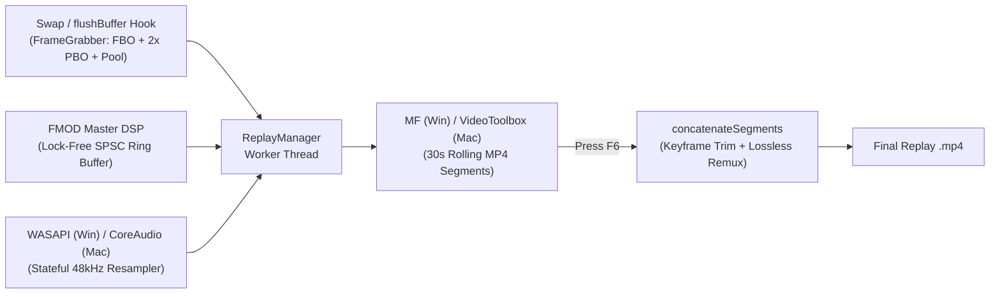

# 🎬 Instant Replay for Geometry Dash (Geode)

> **Developer:** ZeMo (`zemo.instant-replay`)  
> **Platforms:** Windows 64-bit (`x86_64`) & macOS Universal (`arm64` + `x86_64`) | **Geometry Dash:** `2.2081` | **Geode SDK:** `v5.11.2` | **Standard:** C++23 / Objective-C++23

Hardware-accelerated, ShadowPlay-style background **Instant Replay** recorder built natively into Geometry Dash. Continuously buffers the last `N` seconds of gameplay (5s – 3600s) into rolling segments and exports an MP4 on demand (`F6`) with zero FPS drop.

> 🤖 **Using an LLM / AI Coding Assistant?**  
> Read **[AGENTS.md](./AGENTS.md)** (or **[CLAUDE.md](./CLAUDE.md)**) first — it documents every source file, thread boundary, Windows Media Foundation / macOS VideoToolbox pipeline detail, and Geode UI invariant.

---

## ✨ Key Features

- **1-Click Instant Save (`F6`):** Saves the last `5` to `3600` seconds of gameplay into a ready-to-share `.mp4` file.
- **Hardware-Accelerated Encoding:**
  - **Windows:** Windows Media Foundation (`IMFSinkWriter`) across NVIDIA NVENC, AMD AMF, and Intel QuickSync (`AV1 (HW) → HEVC (HW) → H.264 (HW) → H.264 (SW)`).
  - **macOS:** Native Apple VideoToolbox (`AVAssetWriter` + `VTCompressionSession` + `CVPixelBuffer`) with runtime `VTCopyVideoEncoderList` capability probing (e.g., M1/M2 automatically gate unsupported AV1 to HEVC/H.264; software mode prefers H.264) and BT.709 color tagging.
- **Rate Control Modes:** Adaptive VBR (peak-constrained, 5–250 Mbps target / up to 300 Mbps peak), Constant Bitrate (CBR), and Constant Quality (CQ).
- **Zero-Allocation Real-Time Capture:**
  - **Video:** GPU-side FBO scaling (`glBlitFramebuffer`, with Retina backing pixel awareness and Y-flip blit on macOS), double-buffered asynchronous PBO readback (`GL_BGRA`), reusable `CapturedFrame` (`IMFMediaBuffer` / `CVPixelBuffer`) pools, and phase-preserving frame pacing (`60`, `120`, `240` FPS).
  - **Game Audio:** Lock-free SPSC ring buffer attached to the FMOD Master `ChannelGroup` DSP (zero heap allocations or locks on the audio thread).
  - **Microphone Audio (Opt-in):** Event-driven WASAPI capture (Windows) and CoreAudio `AudioQueue` capture with TCC permission checking & automatic default-mic fallback (macOS). Supports **2 separate AAC tracks** (for Premiere Pro / DaVinci Resolve / Vegas) or **real-time single-track mixing**.
- **In-Game Dashboard (`F9`):** 4-tab popup with live Premiere-style file size estimator, Save & TEMP drive disk space warnings, volume sliders, and Unicode-safe folder picker.

---

## 🗂️ Architecture & Source Layout



| Path | Description |
| :--- | :--- |
| [`mod.json`](./mod.json) | Geode mod metadata, settings definitions, and default keybinds |
| [`CMakeLists.txt`](./CMakeLists.txt) | CMake build configuration (Win32/MF libs on Windows; Objective-C++23 ARC + VideoToolbox/AVFoundation/CoreAudio on macOS) |
| [`AGENTS.md`](./AGENTS.md) | Comprehensive architectural & invariant guide for LLMs and developers |
| [`changelog.md`](./changelog.md) | Release changelog |
| [`LICENSE`](./LICENSE) | MIT License |
| [`src/main.cpp`](./src/main.cpp) | Hooks (`$on_game(Exiting)`, `CCEGLView` on Windows, `NSOpenGLContext::flushBuffer` on macOS, `FMODAudioEngine`, menus), keybinds & setting listeners |
| [`src/config/ReplayConfig.hpp`](./src/config/ReplayConfig.hpp) | Thread-safe configuration, snapshots, disk space estimators & `mod.json` sync |
| [`src/capture/FrameGrabber.cpp`](./src/capture/FrameGrabber.cpp) | OpenGL FBO downscaler, async PBO pixel readback, BT.709 `CVPixelBuffer` tagging (macOS), and reusable frame buffer pool |
| [`src/capture/AudioGrabber.cpp`](./src/capture/AudioGrabber.cpp) | Lock-free FMOD DSP game audio ring buffer & stateful WASAPI microphone capture (Windows) |
| [`src/capture/AudioGrabberMac.mm`](./src/capture/AudioGrabberMac.mm) | CoreAudio `AudioQueue` microphone capture, TCC permission handling, and fallback recovery (macOS) |
| [`src/encoder/MediaFoundationEncoder.cpp`](./src/encoder/MediaFoundationEncoder.cpp) | `IMFSinkWriter` encoder & `IMFSourceReader` lossless MP4 remuxer (Windows) |
| [`src/encoder/VideoToolboxEncoder.mm`](./src/encoder/VideoToolboxEncoder.mm) | `AVAssetWriter` + VideoToolbox encoder, bounded deferred audio queues, and `AVAssetReader` lossless MP4 remuxer (macOS) |
| [`src/platform/MacPlatformUtils.mm`](./src/platform/MacPlatformUtils.mm) | Cocoa directories, Retina GL backing size query, `NSOpenGLContext::flushBuffer` hook & PID identity checks (macOS) |
| [`src/platform/MacVideoCapabilities.mm`](./src/platform/MacVideoCapabilities.mm) | Runtime `VTCopyVideoEncoderList` capability detection & oversize Retina probe cache (macOS) |
| [`src/recorder/ReplayManager.cpp`](./src/recorder/ReplayManager.cpp) | Async segment rotation, single-track mic mixer, export file locking, and error recovery |
| [`src/ui/ReplayPopup.cpp`](./src/ui/ReplayPopup.cpp) | In-game 4-tab settings and status popup (`F9`) |
| [`src/ui/CodecGuidePopup.cpp`](./src/ui/CodecGuidePopup.cpp) | In-game GPU / VideoToolbox codec guide popup |
| [`src/ui/ReplayNotification.cpp`](./src/ui/ReplayNotification.cpp) | Custom toast notification on replay save |

---

## 🛠️ Building & Host Tests

### Windows
1. Install [Geode CLI](https://github.com/geode-sdk/cli), [Geode SDK v5.11.2](https://github.com/geode-sdk/geode), CMake 3.21+, Ninja, and Visual Studio 2022 / LLVM (`clang-cl`).
2. Ensure `GEODE_SDK` points to your Geode SDK directory and run `geode build --ninja`.
3. Standalone Windows host tests:
   `clang-cl /std:c++latest /EHsc /O2 /I src tests/host/test_host.cpp /Fe:build/test_host.exe mfplat.lib mfreadwrite.lib mfuuid.lib ole32.lib && .\build\test_host.exe`

### macOS (Universal `arm64` + `x86_64`)
1. Install Xcode Command Line Tools (`clang++`), CMake 3.21+, Ninja, [Geode CLI](https://github.com/geode-sdk/cli), and [Geode SDK v5.11.2](https://github.com/geode-sdk/geode).
2. Ensure `GEODE_SDK` points to your Geode SDK directory and build with:
   ```bash
   cmake -B build -G Ninja -DCMAKE_BUILD_TYPE=RelWithDebInfo
   cmake --build build
   ```
   (or `geode build -p macos`).
3. Standalone macOS host tests (no Geometry Dash runtime required):
   ```bash
   clang++ -std=c++23 -fobjc-arc -fobjc-arc-exceptions -DGEODE_IS_MACOS -DGL_SILENCE_DEPRECATION -Isrc -Itests/host/mock_geode tests/host/test_host_mac.mm src/encoder/VideoToolboxEncoder.mm src/platform/MacVideoCapabilities.mm -framework Foundation -framework AVFoundation -framework VideoToolbox -framework CoreMedia -framework CoreVideo -framework CoreAudio -framework AudioToolbox -framework CoreFoundation -framework OpenGL -o build/test_host_mac && ./build/test_host_mac
   ```
